# session-crew

A Claude Code mod that gives each side session a little pixel crab. When a Claude Code desktop session starts other
sessions, I lose track of which ones are still going and which are waiting on me. This puts them all in view: the crab
walks while its session works, waves a `!` when it needs you, naps when it's idle, and hops about when it's done.

<p align="center"></p>

A strip of crabs sits above the prompt, one card per session that needs a look:

<p align="center"></p>

and each crab's pose tells you where its session is:

<p align="center"></p>

It's a sibling of [savvy-progress](https://github.com/JohnnyVizz/claude-kit/tree/main/plugins/savvy-progress),
which does the same for subagents, and the crabs come from there. It uses the early-access mod API; I built and
tested it on Claude Code 2.1.295 (desktop) and 2.1.286 (terminal).

## Install

```bash
git clone https://github.com/davidcoulson/session-crew ~/dev/session-crew
claude --plugin-dir ~/dev/session-crew
```

For the desktop app, add the folder to `~/.claude/settings.json` (separate several folders with `:`):

```json
"env": { "CLAUDE_CODE_PLUGIN_DIRS": "/path/to/session-crew" }
```

## Use

The strip shows up by itself once a session starts another one. `/crew` opens a pane with every linked session;
click a card's label or a row's **Open** to jump to that session. `/crew face <name> <costume>` picks a crab's
costume, and `/crew import` brings in sessions that were already running before the mod loaded.

Around holidays the crabs dress up (102 outfits across 12 holidays; `/crew holiday off` if that's not your thing):

<p align="center"></p>

Every command, option and status rule is in [docs/reference.md](docs/reference.md).

## Credits and license

The crab art, costumes and their motion are copied from
[savvy-progress](https://github.com/JohnnyVizz/claude-kit/tree/main/plugins/savvy-progress) by
[johnnyvizz](https://github.com/johnnyvizz) (MIT), which credits the pixel crab to DockCrab (Clawdy). The resting
and cheering poses and the holiday outfits are new here. See [THIRD_PARTY_NOTICES.md](THIRD_PARTY_NOTICES.md).

MIT, see [LICENSE](LICENSE).
